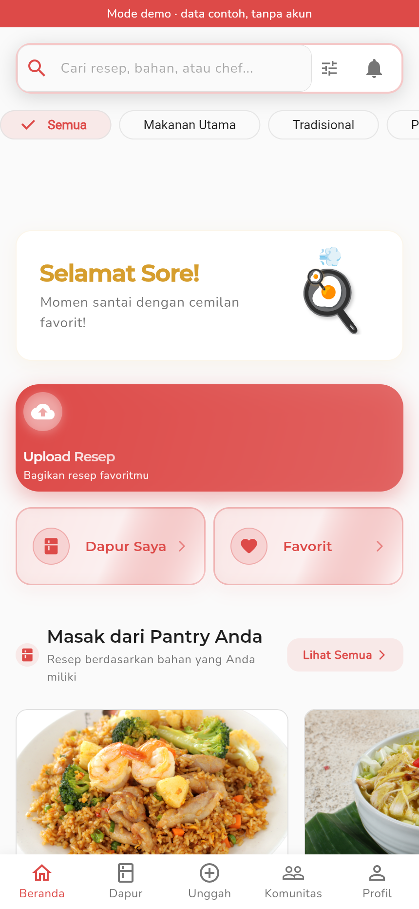
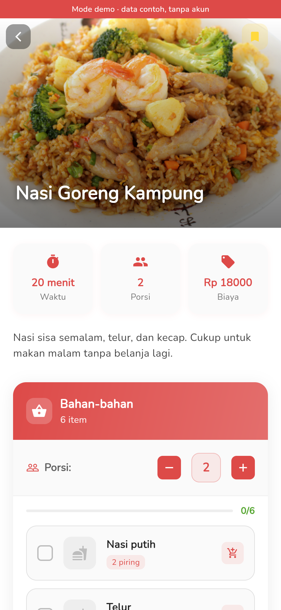
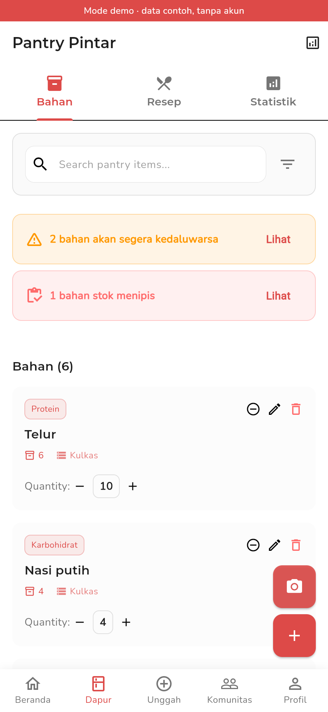
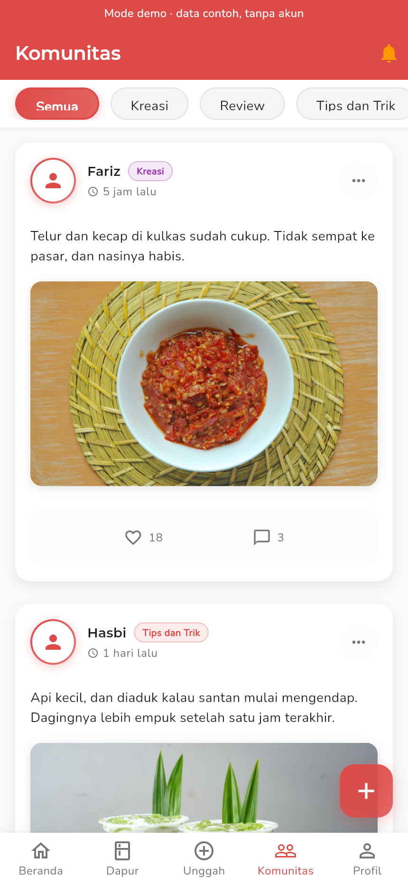

# Rasain

Cook Indonesian food from the ingredients already in your kitchen.

Rasain keeps a pantry list, then suggests recipes you can cook before anything expires. The app is Flutter. The database and auth API live in [rasain-backend](https://github.com/frzxw/rasain-backend).

## Features

- Pantry with quantities, low-stock warnings, and items close to expiry
- Home search and category filters, including recipes that match the pantry
- Recipe pages with cost, portions, ingredients, and a step-by-step cooking mode with timers
- Upload a recipe
- Community posts and recipe reviews
- Accounts, saved recipes, and notifications when Supabase is configured

The interface is in Indonesian.

## Stack

Flutter 3.29 and Dart 3.7. State uses `flutter_bloc` and Provider. Navigation uses `go_router`. The live backend is Supabase (Auth, Postgres, Storage), loaded from a `.env` file.

Demo mode is a compile-time flag. It skips Supabase and serves a small in-memory catalog, so the UI runs with no account and no server.

## Who worked on it

This started as Kelompok 24 in Pemrograman Visual dan Piranti Bergerak.

- A Bintang Iftitah FJ ([ABintangIftitahFj](https://github.com/ABintangIftitahFj))
- Fariz Wibisono ([frzxw](https://github.com/frzxw))
- Hafidz Tantowi
- Hasbi Haqqul Fikri ([Altamish27](https://github.com/Altamish27))
- Putra Hadiyanto Nugroho ([putrahadiyanto](https://github.com/putrahadiyanto))

Fariz owns the repository. He made the first commit, wired Supabase and `.env`, built the pantry tools and notifications, and merged the group branches. Git history also has two commits from mujtabo.

## Screenshots

These are from the web demo (`--dart-define=DEMO_MODE=true`).

| Welcome | Home |
| --- | --- |
|  |  |

| Recipe | Pantry |
| --- | --- | --- |
|  |  |

## Run it locally

Flutter 3.29.3 (Dart 3.7) matches `.metadata`.

```bash
flutter pub get
cp .env.example .env
flutter run
```

The normal run expects Supabase keys in `.env`. To click through the UI without a backend:

```bash
flutter run -d chrome --dart-define=DEMO_MODE=true
```

A release build of that same demo:

```bash
cp .env.example .env
flutter build web --release --dart-define=DEMO_MODE=true
```

Open `build/web`. Routes use a hash (`/#/pantry`). `DEMO_MODE` defaults to false, so a normal mobile build still talks to Supabase.

```bash
flutter analyze
flutter test
```

## Web preview

`vercel.json` builds the demo with `scripts/vercel-build.sh` and publishes `build/web`. A preview URL shows up once a Vercel project is connected to this repo. Nothing here deploys on its own.
